# claude-dashboard



One local page that shows every running [Claude Code](https://code.claude.com) session on your machine, what each one is doing, your token usage for the last week, and a message box per session so you can hand out the next instruction without hunting for the right terminal tab.

No dependencies. Node 22+. macOS, Linux and Windows for the dashboard itself; sending messages needs the Unix socket, so macOS or Linux (WSL 2 works).

## Install

Pick one.

**Run it straight from GitHub, nothing to clone:**

```sh
npx github:kradyy/claude-dashboard
```

**Clone it:**

```sh
git clone https://github.com/kradyy/claude-dashboard.git
cd claude-dashboard
npm start
```

**Download a release tarball:**

```sh
curl -fsSL https://github.com/kradyy/claude-dashboard/archive/refs/tags/v0.1.0.tar.gz | tar xz
cd claude-dashboard-0.1.0
npm start
```

Then open http://localhost:7777. Set `PORT=8000` to use another port. `node server.js --check` runs the built-in self-check.

**Keep it running on macOS** (optional): a launchd agent starts it at login. Run this inside the project folder.

```sh
cat > ~/Library/LaunchAgents/claude-dashboard.plist <<PLIST
<?xml version="1.0" encoding="UTF-8"?>
<!DOCTYPE plist PUBLIC "-//Apple//DTD PLIST 1.0//EN" "http://www.apple.com/DTDs/PropertyList-1.0.dtd">
<plist version="1.0"><dict>
  <key>Label</key><string>claude-dashboard</string>
  <key>ProgramArguments</key><array><string>$(which node)</string><string>$PWD/server.js</string></array>
  <key>RunAtLoad</key><true/><key>KeepAlive</key><true/>
</dict></plist>
PLIST
launchctl load ~/Library/LaunchAgents/claude-dashboard.plist
```

## What it shows

- **Sessions** from `claude agents --json --all`: name, status (busy / waiting / idle), project folder, model, uptime, your last prompt and Claude's last reply (read from the session transcript).
- **Usage** for the last 7 days, read from `~/.claude/projects/**/*.jsonl`: tokens and an estimated cost per day and per model. Transcript parsing is unsupported by Anthropic and may break on a Claude Code update; treat the numbers as estimates.
- **Send**: type into a card and press Enter. The text is delivered over that session's inbox socket (`/tmp/cc-socks/<pid>.sock`), the same channel Claude Code uses for [cross-session messaging](https://code.claude.com/docs/en/cross-session-messaging). A busy session reads it between tool calls, an idle one starts a new turn.
- **History**: each card shows the transcript as a terminal log, with assistant output rendered as markdown and tool calls folded into one line. Scroll to the top to load the full history.
- **Themes**: One Dark by default, plus Light, Dracula, Solarized, Nord, Gruvbox, Monokai, Tokyo Night and GitHub Light. If VS Code or Cursor is installed, their active theme is detected and listed as "VS Code (User)" / "Cursor (User)", and selected automatically until you pick something else. Font size, line height and terminals per row live under Settings.
- **Windows**: yellow light minimizes, green maximizes to the full screen (Esc restores). Drag the bottom-right corner of a log to resize it.

## One setting you probably want

Messages from the dashboard arrive as a peer message, not as keyboard input. A session started with `--dangerously-skip-permissions` holds a peer message behind an approval dialog unless you tell it to accept them. Add this to `~/.claude/settings.json`:

```json
{ "crossSessionInbound": "accept" }
```

Without it every send pops a dialog in the target terminal, which rather defeats the point.

Other things worth knowing:

- A peer message cannot answer a permission prompt and Claude is told it came from another session, not from you.
- Slash commands can't run over the socket, with one exception: `/rename <name>` is sent as a control frame and works. Everything else (`/clear`, `/compact`, `/model`, …) only exists in the terminal UI, so the dashboard refuses it.
- The server binds to `127.0.0.1` only. Put something in front of it if you want it on the LAN.

## Layout

```
server.js    http server, session listing, transcript tail, usage scanner, socket sender
index.html   the page, vanilla JS, polls /api/state every 3 s
banner.svg   README image only
```
